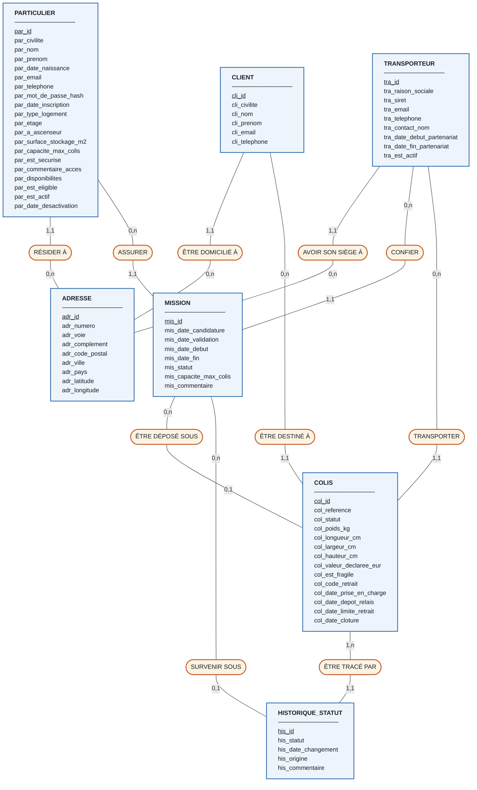

# 4. Modèle Conceptuel de Données (MCD)

**7 entités · 10 associations**

> **Ce que c'est :** le plan de la base, avant tout code. On regroupe les données du dictionnaire en « paquets » (les **entités**) et on relie ces paquets (les **associations**).
>
> **Fichier autonome :** `mcd.mermaid` - à coller sur https://mermaid.live pour l'afficher.
> **Rendu image :** `mcd.svg` et `mcd.png`.

---

## 4.1 Rappel de lecture en 30 secondes

```
┌──────────────┐  0,n                    1,1  ┌──────────┐
│ TRANSPORTEUR │───────( TRANSPORTER )────────│  COLIS   │
└──────────────┘                              └──────────┘
        ▲                    ▲                      ▲
    l'entité           l'association            l'autre entité
   (un rectangle)     (un ovale, un verbe)
```

La cardinalité est écrite **du côté de l'entité** et décrit ce que fait **une seule** occurrence de cette entité :

- côté `TRANSPORTEUR` on lit **`0,n`** → « un transporteur donné peut avoir **de zéro à plusieurs** colis »
- côté `COLIS` on lit **`1,1`** → « un colis donné a **exactement un** transporteur »

| Notation | Signification |
|---|---|
| `0,1` | zéro ou un, jamais plus |
| `1,1` | exactement un |
| `0,n` | de zéro à plusieurs |
| `1,n` | au moins un |

> ⚠️ **Le piège que le sujet signale** (« attention à la position des cardinalités ») : on est tenté d'écrire `0,n` du côté du colis parce qu'on pense « il y a plusieurs colis ». C'est faux. Vérification rapide : `1,1` et `0,n` sont presque toujours **face à face**, jamais du même côté.

---

## 4.2 Le schéma



---

## 4.3 Les entités, une par une

| Entité | Identifiant | Ce qu'elle représente |
|---|---|---|
| `ADRESSE` | `adr_id` | Une adresse postale. Mutualisée : elle sert aux particuliers, aux transporteurs **et** aux clients, plutôt que de recopier 3 fois les mêmes colonnes. |
| `PARTICULIER` | `par_id` | Une personne qui propose son domicile. Contient aussi la description de son logement et ses disponibilités. |
| `TRANSPORTEUR` | `tra_id` | Une société partenaire. |
| `CLIENT` | `cli_id` | Le destinataire final du colis. |
| `MISSION` | `mis_id` | Le contrat entre un particulier et un transporteur, sur une période. |
| `COLIS` | `col_id` | L'objet central du système. Son attribut `col_statut` porte son statut **courant**. |
| `HISTORIQUE_STATUT` | `his_id` | Une ligne par changement d'état. C'est la mémoire du système. |

---

## 4.4 Les associations, une par une

| # | Association | Entité A | Card. A | Entité B | Card. B | Comment ça se lit |
|---|---|---|---|---|---|---|
| A1 | RÉSIDER À | `PARTICULIER` | 1,1 | `ADRESSE` | 0,n | Un particulier réside à une seule adresse ; une adresse peut abriter plusieurs personnes (ou aucune). |
| A2 | AVOIR SON SIÈGE À | `TRANSPORTEUR` | 1,1 | `ADRESSE` | 0,n | Idem pour le siège social. |
| A3 | ÊTRE DOMICILIÉ À | `CLIENT` | 1,1 | `ADRESSE` | 0,n | Idem pour l'adresse de livraison. |
| A4 | ASSURER | `PARTICULIER` | 0,n | `MISSION` | 1,1 | Un particulier peut n'avoir aucune mission (inscrit mais pas encore accepté) ou plusieurs ; une mission concerne toujours un seul particulier. |
| A5 | CONFIER | `TRANSPORTEUR` | 0,n | `MISSION` | 1,1 | Symétrique du précédent, côté transporteur. |
| A6 | TRANSPORTER | `TRANSPORTEUR` | 0,n | `COLIS` | 1,1 | Un colis est pris en charge par un seul transporteur (RG07). |
| A7 | ÊTRE DESTINÉ À | `CLIENT` | 0,n | `COLIS` | 1,1 | Un colis a un seul destinataire ; un client peut en recevoir plusieurs (RG08). |
| A8 | ÊTRE DÉPOSÉ SOUS | `MISSION` | 0,n | `COLIS` | **0,1** | Un colis est déposé sous **au plus une** mission - et sous **aucune** tant qu'il roule (RG09). |
| A9 | ÊTRE TRACÉ PAR | `COLIS` | **1,n** | `HISTORIQUE_STATUT` | 1,1 | Un colis a **au moins une** ligne d'historique ; une ligne concerne un seul colis. |
| A10 | SURVENIR SOUS | `MISSION` | 0,n | `HISTORIQUE_STATUT` | **0,1** | Chaque événement postérieur au dépôt est rattaché à une mission ; les premiers ne le sont pas encore. |

---

## 4.5 Les choix qu'il faut savoir défendre

### ① Le statut du colis est un **attribut**, pas une entité

C'est la question qui revient systématiquement : *« pourquoi les 6 statuts ne sont-ils pas une entité `STATUT_COLIS` reliée au colis ? »*

**La réponse tient en trois critères.** On crée une entité (donc une table de référence) pour une liste de valeurs **si et seulement si** au moins l'un de ces trois points est vrai :

| Critère | Est-ce le cas ici ? |
|---|---|
| La liste **évolue** - le client doit pouvoir ajouter ou renommer des valeurs sans intervention technique | ❌ Non. Les 6 statuts décrivent le parcours physique d'un colis, décrit noir sur blanc dans le cahier des charges. Ils ne bougeront pas. |
| La valeur **porte des données propres** (un libellé traduit, une couleur d'affichage, un délai associé…) qu'il faudrait maintenir | ❌ Non. Le code du statut se suffit à lui-même. |
| La liste doit être **référencée par d'autres tables** avec une intégrité garantie | ❌ Plus maintenant : le type énuméré garantit lui-même que seules ces 6 valeurs sont acceptables, dans `colis` comme dans `historique_statut`. |

Aucun critère n'est rempli → **un attribut de type énuméré suffit**. On économise une table, une clé étrangère par usage, et une jointure dans chaque requête.

> **Ce que l'énuméré garantit quand même.** Ce n'est pas du texte libre : la base **refuse** toute valeur en dehors de la liste. Écrire `'DEPOSÉ'` ou `'depose_relais'` provoque une erreur, exactement comme une clé étrangère invalide l'aurait fait. On ne perd donc rien sur l'intégrité.
>
> **Le bonus.** On déclare les 6 valeurs **dans l'ordre du parcours**. MySQL trie un énuméré selon cet ordre de déclaration, et non par ordre alphabétique : un simple `ORDER BY his_statut` restitue donc le déroulé chronologique du colis. C'est exactement ce que faisait la colonne `sta_ordre` de l'ancienne table de référence - gratuitement.

**Et le prix à payer ?** Deux choses, mineures ici :

1. **Ajouter un 7ᵉ statut** demandera un `ALTER TABLE ... MODIFY COLUMN` au lieu d'un simple `INSERT`. C'est une opération de maintenance, pas de production courante - acceptable pour une liste qui, par définition, ne bouge pas.
2. **Le libellé lisible** (« Déposé au point relais ») n'est plus stocké. Il est reconstitué par une expression `CASE` dans les vues, ou géré par l'interface. C'est le choix habituel : le code technique vit dans la base, le texte affiché vit dans l'application - ce qui facilite d'ailleurs une future traduction.

> **La règle générale à retenir :**
> **liste figée et sans données propres → énuméré. Liste administrable ou porteuse d'informations → table de référence.**
> Le type de logement (`par_type_logement`) et le statut de mission (`mis_statut`) relèvent du même raisonnement, et sont donc eux aussi des énumérés.

### ② `MISSION` est une entité, pas une simple association

Le lien « un particulier travaille pour un transporteur » est un lien **plusieurs-à-plusieurs** : un particulier peut servir plusieurs transporteurs, un transporteur s'appuie sur plusieurs particuliers.

Normalement on le représente par une association simple. Mais ici, deux raisons imposent d'en faire une **entité à part entière** :

1. **Le lien porte des informations propres** : dates de début et de fin, statut de la candidature, quota de colis alloué.
2. **Le lien doit être désigné par d'autres éléments** : le colis dit « je suis déposé sous cette mission », l'historique dit « cet événement est survenu sous cette mission ». Or **en Merise, une association ne peut pas être reliée à une autre association**. C'est cette raison-là qui tranche.

Transformer une association en entité s'appelle une **réification**. C'est un cas d'école, et c'est exactement ce que l'exercice cherche à faire découvrir.

**Le bénéfice concret :** le cahier des charges exige que l'historique contienne « le point relais concerné et le transporteur responsable ». Grâce à la mission, ces deux informations sont accessibles **d'un seul coup**, sans avoir à les recopier dans chaque ligne d'historique.

### ③ `A8` porte un `0,1` du côté `COLIS` - le point le plus important du schéma

Tant que le colis est `EN_COURS_LIVRAISON`, il roule dans un camion : **il n'est rattaché à aucun point relais**, donc à aucune mission. Le rattachement n'a lieu qu'au moment du dépôt.

Écrire `1,1` ici serait une erreur qui rendrait **impossible** l'enregistrement d'un colis en tournée - c'est-à-dire de tout colis à sa création. C'est le genre d'erreur qu'on ne détecte qu'au moment d'insérer les premières données, quand il est déjà tard.

### ④ `A9` porte un `1,n` et non un `0,n`

Dès sa création, un colis est `EN_COURS_LIVRAISON` : cela constitue **déjà** une première ligne d'historique. Un colis sans aucun historique serait une incohérence - c'est d'ailleurs l'un des contrôles automatiques du fichier `07_tests_use_cases.sql` (test T2).

### ⑤ `colis.col_statut` fait doublon avec l'historique - et c'est assumé

L'attribut `col_statut` donne le statut courant. On pourrait le retrouver en cherchant la ligne d'historique la plus récente. C'est donc une redondance.

Elle est volontaire, pour des raisons de performance : la question « quels colis sont en attente de retrait ? » est posée en permanence sur un gros volume. Le détail est au §2.4 du document 01. Un puriste supprimerait cet attribut du MCD pour ne le réintroduire qu'à l'implémentation - c'est une position parfaitement défendable techniquement.

---

## 4.6 Ce que le MCD ne sait pas exprimer

Le formalisme entités/associations est puissant mais limité. Ces règles-là ne peuvent pas être dessinées, et devront être portées ailleurs :

| Règle | Où elle sera appliquée |
|---|---|
| L'ordre des étapes du parcours : on ne passe pas de `EN_COURS_LIVRAISON` directement à `REPRIS_TRANSPORTEUR` | Programme (couche applicative) |
| RG06 : une seule mission active à la fois par couple (particulier, transporteur) | Programme, ou déclencheur SQL |
| RG13 : le nombre de colis gardés ne dépasse pas la capacité déclarée | Programme, ou déclencheur SQL |
| Le transporteur du colis doit être celui de la mission de dépôt | Programme, ou déclencheur SQL |
| RG10 : date limite = dépôt + 14 jours | **Colonne calculée par la base** |
| RG12 : `col_statut` = dernier statut historisé | Programme (les deux écritures dans la même transaction) |
| Poids positif, code postal à 5 chiffres, statut appartenant à la liste des 6 | **Contraintes `CHECK` et type énuméré** |

> C'est normal et attendu : le MCD décrit la **structure**, pas le **comportement**. Savoir dire ce qui n'est pas modélisable est un signe de maîtrise, pas un aveu de faiblesse.
