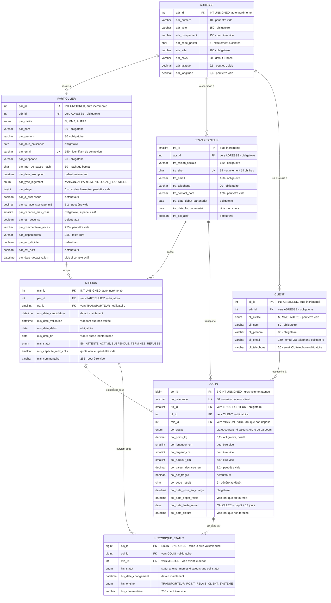
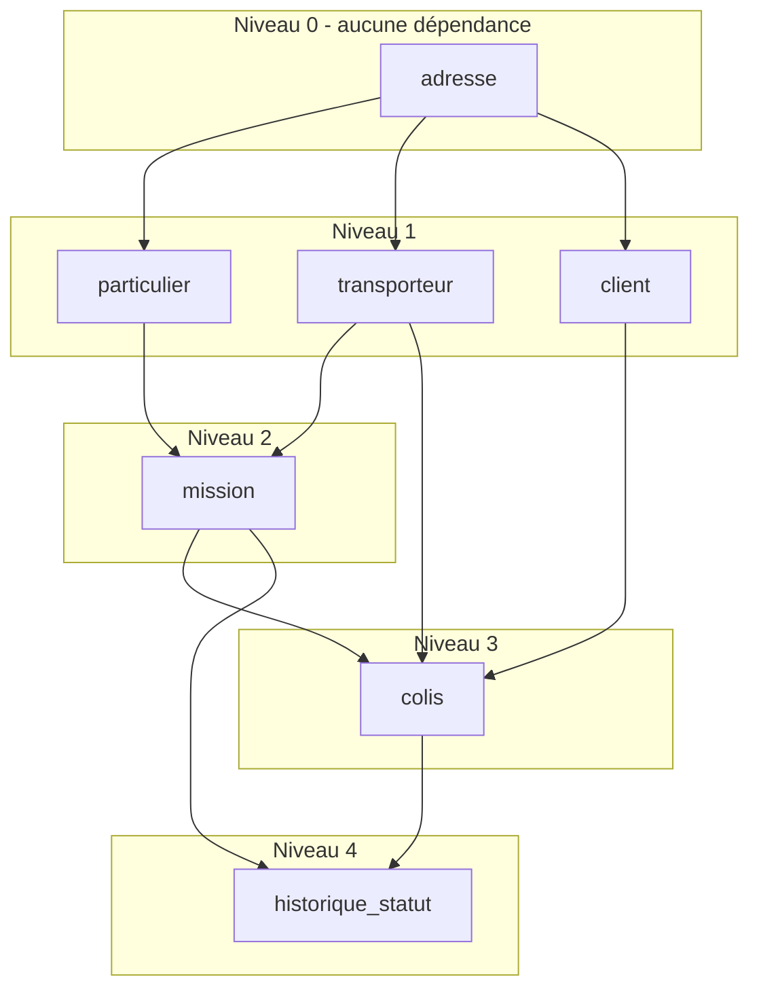

# 5. Modèle Logique de Données (MLD)

**7 tables · 10 clés étrangères · aucune table d'association supplémentaire**

> **Ce que c'est :** le MCD traduit en tables. Les ovales (associations) disparaissent, remplacés par des **clés étrangères** - c'est-à-dire des colonnes qui contiennent l'identifiant d'une ligne d'une autre table.
>
> **Bonne nouvelle :** cette traduction est **mécanique**. Trois règles, aucune décision à prendre.
>
> **Fichier autonome :** `mld.mermaid` - à coller sur https://mermaid.live.
> **Rendu image :** `mld.svg` et `mld.png`.

---

## 5.1 Les trois règles de transformation

### Règle 1 - les deux côtés sont `0,1` ou `1,1` (lien « un à un »)

On ajoute la clé primaire de l'une des deux tables dans l'autre, en tant que clé étrangère, avec une contrainte d'unicité.

> **Ce cas n'apparaît pas dans notre modèle**, et c'est voulu : le lien 1-à-1 entre le particulier et son logement a été supprimé, les informations du logement étant devenues **des colonnes de `particulier`**.
>
> C'est le bon réflexe en général : **quand deux tables sont en 1-à-1, il faut se demander si elles ne devraient pas n'en faire qu'une.** Deux tables qui auront toujours exactement le même nombre de lignes sont rarement justifiées.

### Règle 2 - un côté `1,1` ou `0,1`, l'autre `0,n` ou `1,n` (lien « un à plusieurs »)

**C'est le cas de nos 10 associations.**

La clé primaire du côté « plusieurs » **descend** comme clé étrangère du côté « un ».

```
AVANT - le MCD
┌──────────────┐  0,n                    1,1  ┌──────────┐
│ TRANSPORTEUR │───────( TRANSPORTER )────────│  COLIS   │
└──────────────┘                              └──────────┘

APRÈS - le MLD
┌─────────────────────┐              ┌──────────────────────┐
│ transporteur        │              │ colis                │
│  tra_id        (PK) │◄─────────────│  col_id         (PK) │
│  tra_raison_sociale │              │  tra_id         (FK) │ ← la clé est venue ici
│  tra_siret          │              │  col_reference       │
│  ...                │              │  col_poids_kg        │
└─────────────────────┘              └──────────────────────┘
```

**Pourquoi dans ce sens ?** Un colis n'a qu'un transporteur : on peut donc écrire son identifiant dans la ligne du colis. L'inverse serait absurde - un transporteur a des milliers de colis, on ne va pas ajouter des milliers de colonnes à sa ligne.

Voici les 10 clés étrangères ainsi créées :

| Association du MCD | Clé étrangère créée | Dans la table | Peut être vide ? |
|---|---|---|---|
| A1 RÉSIDER À | `adr_id` | `particulier` | non |
| A2 AVOIR SON SIÈGE À | `adr_id` | `transporteur` | non |
| A3 ÊTRE DOMICILIÉ À | `adr_id` | `client` | non |
| A4 ASSURER | `par_id` | `mission` | non |
| A5 CONFIER | `tra_id` | `mission` | non |
| A6 TRANSPORTER | `tra_id` | `colis` | non |
| A7 ÊTRE DESTINÉ À | `cli_id` | `colis` | non |
| A8 ÊTRE DÉPOSÉ SOUS | `mis_id` | `colis` | **oui** |
| A9 ÊTRE TRACÉ PAR | `col_id` | `historique_statut` | non |
| A10 SURVENIR SOUS | `mis_id` | `historique_statut` | **oui** |

> **L'astuce de relecture qui vaut de l'or.** Le minimum de la cardinalité se traduit directement :
> - une patte **`1,1`** → clé étrangère **obligatoire** (`NOT NULL`)
> - une patte **`0,1`** → clé étrangère **facultative** (peut rester vide)
>
> Si l'on obtient une colonne obligatoire alors que le métier dit « ça peut être vide », **c'est que la cardinalité était fausse dans le MCD**.
C'est le meilleur moyen de relire son propre travail. Chez nous, les deux seules clés étrangères facultatives sont `colis.mis_id` et `historique_statut.mis_id` (exactement les deux pattes en `0,1`). Cohérent.

### Règle 3 - les deux côtés sont `0,n` ou `1,n` (lien « plusieurs à plusieurs »)

Aucune des deux tables ne peut accueillir la clé de l'autre. On crée une **troisième table** contenant les deux clés.

Dans notre projet, le seul lien plusieurs-à-plusieurs était « un particulier travaille pour plusieurs transporteurs et réciproquement »… et il a déjà été traité au MCD en créant l'entité `MISSION`.

**Autrement dit : `mission` EST notre table d'association.** Elle contient `par_id` + `tra_id`, plus ses propres données.

La seule différence avec une table d'association « classique » : on lui a donné une clé primaire technique `mis_id`, au lieu d'utiliser le couple `(par_id, tra_id)`. C'est **obligatoire** ici, parce qu'un même couple peut avoir plusieurs missions successives dans le temps - le couple ne serait donc pas unique.

### Et les attributs énumérés ?

`col_statut`, `his_statut`, `par_type_logement`, `mis_statut`, `cli_civilite`, `par_civilite`, `his_origine` sont de simples **colonnes**. Ils ne génèrent ni table ni clé étrangère : la liste des valeurs autorisées est inscrite dans la définition de la colonne, et la base refuse tout ce qui n'y figure pas.

> **Attention à une confusion fréquente.** « Énuméré » ne veut pas dire « texte libre ». Une colonne `ENUM('EN_COURS_LIVRAISON','DEPOSE_RELAIS',…)` n'accepte **que** ces valeurs : écrire `'Déposé'` provoque une erreur, exactement comme une clé étrangère invalide. L'intégrité est la même ; c'est seulement le mécanisme qui change.

---

## 5.2 Le MLD en notation textuelle

> **Notation :** clé primaire en premier · `#` = clé étrangère · `⇒` = table citée · `*` = peut rester vide

```
ADRESSE            (adr_id, adr_numero*, adr_voie, adr_complement*, adr_code_postal,
                    adr_ville, adr_pays, adr_latitude*, adr_longitude*)

PARTICULIER        (par_id, #adr_id ⇒ ADRESSE, par_civilite, par_nom, par_prenom,
                    par_date_naissance, par_email, par_telephone, par_mot_de_passe_hash,
                    par_date_inscription, par_type_logement, par_etage*,
                    par_a_ascenseur, par_surface_stockage_m2*, par_capacite_max_colis,
                    par_est_securise, par_commentaire_acces*, par_disponibilites*,
                    par_est_eligible, par_est_actif, par_date_desactivation*)

TRANSPORTEUR       (tra_id, #adr_id ⇒ ADRESSE, tra_raison_sociale, tra_siret, tra_email,
                    tra_telephone, tra_contact_nom*, tra_date_debut_partenariat,
                    tra_date_fin_partenariat*, tra_est_actif)

CLIENT             (cli_id, #adr_id ⇒ ADRESSE, cli_civilite*, cli_nom, cli_prenom,
                    cli_email*, cli_telephone*)

MISSION            (mis_id, #par_id ⇒ PARTICULIER, #tra_id ⇒ TRANSPORTEUR,
                    mis_date_candidature, mis_date_validation*, mis_date_debut,
                    mis_date_fin*, mis_statut, mis_capacite_max_colis*, mis_commentaire*)

COLIS              (col_id, col_reference, #tra_id ⇒ TRANSPORTEUR, #cli_id ⇒ CLIENT,
                    #mis_id* ⇒ MISSION, col_statut, col_poids_kg,
                    col_longueur_cm*, col_largeur_cm*, col_hauteur_cm*,
                    col_valeur_declaree_eur*, col_est_fragile, col_code_retrait*,
                    col_date_prise_en_charge, col_date_depot_relais*,
                    col_date_limite_retrait* [calculée], col_date_cloture*)

HISTORIQUE_STATUT  (his_id, #col_id ⇒ COLIS, #mis_id* ⇒ MISSION, his_statut,
                    his_date_changement, his_origine, his_commentaire*)
```

---

## 5.3 Le schéma relationnel



---

## 5.4 Classement des tables par niveau de dépendance

**À quoi ça sert ?** Une table qui contient une clé étrangère **ne peut pas être créée avant** la table qu'elle cite : la base refuserait. Ce classement donne donc directement l'ordre des `CREATE TABLE` dans le script - et aussi l'ordre des insertions de données.

| Niveau | Tables | Ce qu'elles citent |
|---|---|---|
| **Niveau 0** - aucune clé étrangère | `adresse` | - |
| **Niveau 1** | `particulier` · `transporteur` · `client` | → `adresse` |
| **Niveau 2** | `mission` | → `particulier`, `transporteur` |
| **Niveau 3** | `colis` | → `mission`, `transporteur`, `client` |
| **Niveau 4** | `historique_statut` | → `colis`, `mission` |



> Pour **supprimer**, c'est exactement l'inverse : niveau 4 d'abord, niveau 0 en dernier.
>
> Notez que la suppression de la table de référence des statuts a **simplifié le niveau 0** : il ne contient plus qu'une seule table.

---

## 5.5 Que se passe-t-il si on supprime une ligne citée ailleurs ?

C'est une vraie décision métier, pas un détail technique. Pour chaque clé étrangère, on choisit un comportement :

- **`RESTRICT`** = « on refuse la suppression tant que des lignes citent celle-ci » ;
- **`CASCADE`** = « on supprime aussi toutes les lignes qui la citent ».

| Clé étrangère | Comportement | Pourquoi |
|---|---|---|
| `particulier.adr_id`, `transporteur.adr_id`, `client.adr_id` | `RESTRICT` | On ne supprime pas une adresse encore utilisée par quelqu'un. |
| `mission.par_id`, `mission.tra_id` | `RESTRICT` | Une mission est une trace contractuelle. Pour arrêter un partenariat, on le désactive - on ne l'efface pas. |
| `colis.tra_id`, `colis.cli_id`, `colis.mis_id` | `RESTRICT` | Effacer un de ces éléments détruirait la traçabilité des colis. |
| `historique_statut.col_id` | **`CASCADE`** | Si un colis est réellement purgé (obligation RGPD par exemple), son historique n'a plus aucun sens : il part avec lui. |
| `historique_statut.mis_id` | `RESTRICT` | Préservation de l'historique. |

**Et `ON UPDATE` ?** `RESTRICT` partout. Toutes nos clés primaires sont des numéros auto-incrémentés, qui ne changent jamais : un `ON UPDATE CASCADE` ne se déclencherait donc jamais.

> 🔧 **Un piège technique rencontré à l'exécution, qui vaut d'être connu.**
> Sur MariaDB, une colonne portant un `ON UPDATE CASCADE` ou un `ON DELETE SET NULL` **ne peut pas apparaître dans une contrainte `CHECK`** (erreur 1901). Concrètement, on ne pouvait pas à la fois mettre `ON UPDATE CASCADE` sur `colis.mis_id` **et** poser la règle « un colis déposé a forcément une mission ». Le choix de `ON UPDATE RESTRICT` - qui était de toute façon le bon - débloque la situation.
> C'est typiquement le genre de détail qu'on ne découvre qu'en exécutant réellement son script, jamais en le relisant.

---

## 5.6 Les index

Un **index** est un raccourci de recherche : sans lui, la base parcourt toute la table pour trouver les lignes qui l'intéressent. Les clés primaires et les contraintes d'unicité en créent automatiquement ; on ajoute les suivants pour les recherches les plus fréquentes :

| Index | Sur la table | Colonnes | Requête accélérée |
|---|---|---|---|
| `idx_colis_statut_limite` | `colis` | `col_statut`, `col_date_limite_retrait` | UC22 / UC24 - trouver les colis dont le délai est dépassé |
| `idx_colis_mission` | `colis` | `mis_id`, `col_statut` | UC07 - les colis gardés par un point relais |
| `idx_historique_colis_date` | `historique_statut` | `col_id`, `his_date_changement` | UC18 / UC19 - l'historique d'un colis dans l'ordre |
| `idx_adresse_code_postal` | `adresse` | `adr_code_postal` | UC09 - chercher des points relais par zone |
| `idx_mission_periode` | `mission` | `mis_statut`, `mis_date_debut`, `mis_date_fin` | RG04 - les missions en cours aujourd'hui |

> Un effet de bord agréable du passage à l'énuméré : ces index portent maintenant **directement** sur le statut, sans passer par une clé étrangère vers une table de référence. Une jointure de moins dans chaque requête de consultation.
